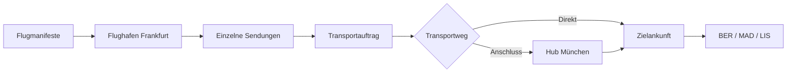

# Abschluss-Challenge – Camel International Airport

**Startbranch:** `16-airport-challenge`  
**Referenz:** `16-airport-challenge-final`  
**Basis:** `15-jms-final`; bisherige Camel-Beispiele liegen weiterhin in `playground/`.

## Auftrag

Am Flughafen Frankfurt (`FRA`) kommen Flugmanifeste an. Jedes Manifest enthält einzelne Passagiere und Pakete. Die Sendungen gehen entweder direkt zum Ziel oder über den Zwischenflughafen München (`MUC`).

**Fachliche Anforderungen:**

1. Drei JSON-Flugmanifeste aus `challenge/data/inbox/` einlesen.
2. Jede Sendung unabhängig verarbeiten; die Manifest-ID (`flightId`) bleibt erhalten.
3. Eine Sendungs-ID innerhalb eines Anwendungsdurchlaufs nur einmal übernehmen; `C001` ist absichtlich doppelt.
4. Je angenommener Sendung einen Audit-Datensatz unter `data/audit/` erzeugen.
5. Producer und Consumer durch die JMS-Queue `airport.dispatch` zeitlich entkoppeln.
6. Bei `route = VIA_HUB` einen Zwischenstopp unter `data/transfers/MUC/` erfassen.
7. Für jede Sendung genau eine Ankunft unter `data/arrivals/<destination>/` schreiben.

Die Fachlogik ist im Startbranch **nicht implementiert**. Nutzt die vorhandenen Workshop-Routen als Referenz. Lösungswege dürfen sich unterscheiden.



## Projekt öffnen und starten

**Voraussetzungen:** Java 21+, Docker. Maven wird über den mitgelieferten Maven Wrapper ausgeführt. Für IntelliJ `challenge/pom.xml` als Maven-Projekt importieren.

Vom Repository-Root:

```bash
# Vorhandene Artemis-Instanz aus dem Workshop nutzen
docker compose up -d
cd challenge

# Zwei unabhängige Terminals/IntelliJ Run Configurations:
./mvnw spring-boot:run -Dspring-boot.run.profiles=producer
./mvnw spring-boot:run -Dspring-boot.run.profiles=consumer
```

Die Startklasse ist `workshop.airport.AirportApplication`. In IntelliJ jeweils `producer` bzw. `consumer` als *Active profiles* einstellen. Producer und Consumer dürfen nicht gleichzeitig im selben Spring-Prozess aktiv sein.

Wenn beide Prozesse gestartet sind, vom Ordner `challenge/` aus:

```bash
mkdir -p data/inbox
cp sample-data/*.json data/inbox/
python3 verify.py
```

Die Python-Prüfung **erst ausführen, nachdem die Nachrichten verarbeitet wurden**; sie benötigt nur die Python-Standardbibliothek.

## Erwartete Ergebnisse

| Prüfung | Erwartung |
| --- | ---: |
| Flugmanifeste | 3 |
| Eingabeeinträge | 9 |
| Eindeutige Sendungen | 8 |
| Über MUC | 4 |
| `data/audit/*.json` | 8 |
| `data/transfers/MUC/*.json` | 4 |
| `data/arrivals/{BER,MAD,LIS}/*.json` | 8 |

Ankünfte: **BER** `P001,C003,P004`; **MAD** `C001,C002,P003`; **LIS** `P002,C004`.

`C001` soll trotz Wiederholung nur einmal angenommen werden. Ein Dateiname pro Sendungs-ID macht den Zustand leicht überprüfbar; daraus allein folgt aber keine produktive Exactly-once-Garantie.

## Hinweise für die Umsetzung

Die beiden Routen sind bewusst leer. `FlightManifest` und `Shipment` enthalten bereits alle benötigten Felder und Jackson-kompatible Getter/Setter. Maven Wrapper, Spring Boot, Artemis und Camel sind vorkonfiguriert. Die JMS-Queue `airport.dispatch` ist unabhängig von `loan.applications`.

Für erweiterte EIPs: [Camel-Dokumentation](https://camel.apache.org/manual/enterprise-integration-patterns.html).

## Wiederholte Testläufe

Vor einem neuen Testlauf **beide Spring-Prozesse beenden**, die Queue `airport.dispatch` leeren und `challenge/data/` entfernen. Bei laufendem Producer würde ein `rm -rf data` außerdem das File-Polling beeinflussen. Die In-Memory-Duplikaterkennung gilt nur bis zum Neustart des Producer-Prozesses.

## Grenzen

Das ist eine Lernaufgabe: keine persistente Duplikaterkennung, keine transaktionale Verbindung zwischen Audit und JMS, keine vollwertige Zustellungsbestätigung oder Ausfallsimulation. Die Modellierung des Zwischenstopps erfolgt über eine eigene Verarbeitungsroute; ein physischer Flugplan ist nicht Teil der Aufgabe.
